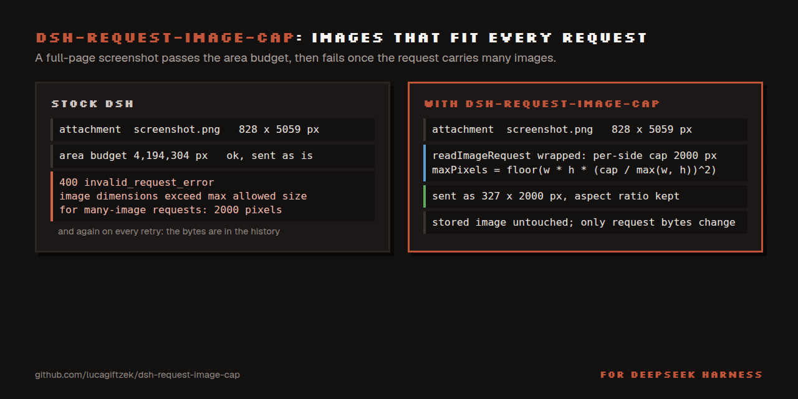

# dsh-request-image-cap

Clamps every image sent to the model to a pixel cap, so many-image requests stop failing.

```bash
dsh plugin --profile web add github:lucagiftzek/dsh-request-image-cap
# then restart dsh web
```



Keep every image DSH transmits inside the provider's **per-side** pixel limit.

## Why

The Anthropic Messages API accepts 8000 px per side for an ordinary request but
only **2000 px per side once the request carries many images**:

```
400 invalid_request_error
messages.10.content.5.image.source.base64.data: At least one of the image
dimensions exceed max allowed size for many-image requests: 2000 pixels
```

Both DSH image gates are **area** gates:

| stage | knob | default |
| --- | --- | --- |
| ingest (`dsh-attachment-local`) | `normalizedImageMaxPixels` / `normalizedImageMaxDimension` | 4 194 304 px² / 8192 px |
| request projection (`requestImageDimensions`) | `llm-pi-ai.requestImagePixelBudget` | 4 194 304 px² |

A full-page screenshot therefore lands in the store as e.g. `828x5059` (inside
the area budget, far outside the per-side rule) and is transmitted verbatim.
The failure is latent: the same image is fine in a short request and only kills
a long session later, then on every retry, because the bytes are already in the
history.

## What it does

Wraps `ctx.attachments.readImageRequest(ref, policy, signal)` (the single seam
every LLM adapter uses to materialise request bytes) and converts a per-side
cap into the area budget that produces it:

```
maxPixels' = floor(w * h * (cap / max(w, h))^2)
```

`requestImageDimensions` scales by `sqrt(maxPixels/(w*h))` and floors, so the
long edge lands at or under `cap`, aspect ratio preserved.

* **retroactive**: acts at request time, so histories that already contain
  oversized images become sendable again;
* **non-destructive**: stored bytes are untouched, only the model copy shrinks;
* **never widens** a route policy that is already tighter;
* **fails safe**: if a core upgrade renames the seam it logs a warning and
  stays inert rather than throwing at boot;
* **free**: Anthropic resizes anything above ~1.15 MP server-side anyway.

## Config

```yaml
- id: request-image-cap
  config:
    enabled: true
    maxDimension: 2000   # 64..8192
    verbose: false       # log every clamp
```

## Install

```bash
dsh plugin --profile web add github:lucagiftzek/dsh-request-image-cap
```

The package declares `dsh.bundle`, so it joins `dsh.profile.bundles` and its own patch
inserts the entry. Override values with a `- id: request-image-cap` row (`config:` only, no
second `insert`) in your profile's `cordis.patch.yml`. It mounts at boot: restart `dsh web`
after installing; the log then shows `request-image-cap: active, 2000px per side`.
A local checkout works too: `dsh plugin --profile web add link:/absolute/path/to/dsh-request-image-cap`.
Requires Node 22.18 or newer; used on DSH 0.1.5 and 0.2.1 (the seam is `ctx.attachments.readImageRequest`).

## Test

```
npm test    # node --test test/*.test.js
```

The tests call the real `requestImageDimensions` of your installed DSH. They find it under
`DSH_GLOBAL_PREFIX` or the global prefix of the running `node`; set `DSH_GLOBAL_PREFIX` if
DSH lives elsewhere.

Proof on the worst object found in a real attachment store:
`828x5059` (388 KB) → `327x1998` (79 KB).

## Upstream

The real fix belongs in `requestImageDimensions`: a route-owned
`maxDimension` beside `maxPixels`. This plugin is the local stand-in.

## When something goes wrong

- Ask your agent to load the **`image-cap-doctor`** skill (copy `skills/image-cap-doctor`
  into `~/.dsh/skills/` once, [how](docs/TROUBLESHOOTING.md#skill)).
- Symptom-first guide: [docs/TROUBLESHOOTING.md](docs/TROUBLESHOOTING.md).
- Messages and log lines: [docs/ERRORS.md](docs/ERRORS.md).

---

## More plugins by the same author

All of them are open source and run on DeepSeek Harness 0.2.x (several on 0.1.5 too).

| Plugin | What it does |
|:---|:---|
| [dsh-artifacts](https://github.com/lucagiftzek/dsh-artifacts) | An Artifacts tab that lists the files an agent produced and previews them in place, plus a template library agents can use and extend |
| [dsh-mail](https://github.com/lucagiftzek/dsh-mail) | Mail client and agent mail tools: IMAP, POP3, SMTP and OAuth2 accounts, scheduled and bulk sends with unsubscribe handling |
| [dsh-note-keeper](https://github.com/lucagiftzek/dsh-note-keeper) | Obsidian-compatible Markdown notes in the sidebar with search, graph, audio notes and transcription, OCR and client-side encryption |
| [dsh-phone](https://github.com/lucagiftzek/dsh-phone) | SMS and calls (Twilio, SIP via Asterisk) with call audio through your own server, live voicemail and Telegram |
| [dsh-voice](https://github.com/lucagiftzek/dsh-voice) | Read-aloud, dictation and language-aware speech with 23 TTS and STT providers, per-language routing and word highlighting |
| [dsh-orchestrator](https://github.com/lucagiftzek/dsh-orchestrator) | Agent swarm and task orchestration: an Orchestrate tab, `orch_*` tools, runners, provider cards and a machine API |
| [dsh-workspace-rail](https://github.com/lucagiftzek/dsh-workspace-rail) | A workspace-first sidebar rail: pinned chats, projects as folders, live Recents, search and unread markers |
| [DSH-Idle-Watchdog](https://github.com/lucagiftzek/DSH-Idle-Watchdog) | Idle-chat nudges and an authenticated HTTP API that posts a prompt into any chat |
| [dsh-plugin-updates](https://github.com/lucagiftzek/dsh-plugin-updates) | Update checker that only offers releases your running DSH core can load |
| [dsh-subagent-tiering](https://github.com/lucagiftzek/dsh-subagent-tiering) | Subagents default to a cheaper sibling of the parent model unless the agent names a route |
| [dsh-fs-reobserve](https://github.com/lucagiftzek/dsh-fs-reobserve) | Ends self-inflicted stale-file errors after an agent's own shell commands |
| [dsh-request-image-cap](https://github.com/lucagiftzek/dsh-request-image-cap) (this one) | Clamps every image sent to the model to a pixel cap, fixing many-image request errors |
| [dsh-seal](https://github.com/lucagiftzek/dsh-seal) | An encrypted channel in front of DSH: a Go reverse proxy plus a service worker that seal all DSH browser traffic |

Built by Luca Tzekos, who also makes [**Job Opportunities API**](https://jobopportunitiesapi.org): employer-direct job data with per-field provenance you can verify yourself, free to read and available as an API. If this plugin is useful to you, a star on this repo or a look at [jobopportunitiesapi.org](https://jobopportunitiesapi.org) is the best thanks.
